# ⚙️ CPU Scheduler Lab

 

CPU Scheduler Lab is a small operating-systems teaching tool for comparing First Come, First Served (FCFS) and non-preemptive Shortest Job First (SJF) scheduling.

## 💡 Why it exists

Scheduling formulas are easier to understand when learners can see execution order, waiting time, and completion time. This lab connects the arithmetic to a Gantt-style timeline.

## ✨ Features

- Enter process names and CPU burst durations.
- Compare FCFS with non-preemptive SJF.
- Render a proportional Gantt-style timeline.
- Calculate waiting and turnaround times for a simplified model.
- No external library or backend.

## 🧩 Design

The browser parses a process list, orders it by the selected policy, computes cumulative start and finish times, and renders a timeline and metrics table.

~~~text
cpu-scheduler-lab/
|-- README.md
|-- index.html
~~~

## ⚙️ Requirements and setup

Open index.html in a modern browser. No build step is needed.

## 🚀 Quick start

Enter P1:5,P2:3,P3:2 and run FCFS, then switch to SJF. The initial version assumes all processes arrive at time zero.

## 🧪 Example

For the sample above, FCFS runs P1 first, while SJF runs P3, then P2, then P1. The displayed waiting times make the difference visible.

## 🎯 Model limitations

This first version does not model arrival times, preemption, I/O blocking, context-switch overhead, or multiple CPU cores. Its numbers are intended for learning the two included policies.

## 🗺️ Roadmap

- [ ] Add process arrival times.
- [ ] Add Round Robin with a configurable time quantum.
- [ ] Add preemptive SJF and context-switch markers.
- [ ] Export a schedule as CSV.

## 🤝 Contributing

Contributions are welcome. Include a small process list and expected schedule when reporting an algorithm issue.

## 📄 License

No license file has been selected yet. Do not assume redistribution or reuse rights until a license is added.
